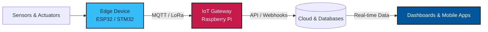

<!-- ============================== HEADER ============================== -->

  

  
  

  
  
  

<!-- ============================== ABOUT ============================== -->

##  About Me

I'm an **IoT Engineering** student at **King Mongkut's Institute of Technology Ladkrabang (KMITL)** who builds connected systems end to end — from sensor wiring and firmware up to the cloud and the dashboard.

- 🔭 Building **IoT systems** and **embedded solutions**
- 🌱 Learning **LoRaWAN**, **FreeRTOS** and **Industrial IoT (IIoT)**
- 📡 Interested in signal processing, edge devices and real-time data
- ⚡ I love building things that bridge the gap between hardware and software

 

<!-- ============================== STACK ============================== -->

##  Tech Stack

<table align="center">
  <tr>
    <td align="center" width="50%"><b>🔌 Hardware &amp; Embedded</b></td>
    <td align="center" width="50%"><b>💻 Software &amp; Cloud</b></td>
  </tr>
  <tr>
    <td align="center">
        
      
      
      
      
      
    </td>
    <td align="center">
       
      
    </td>
  </tr>
</table>

<!-- ============================== ARCHITECTURE ============================== -->

##  How I Build IoT Systems

<!-- ============================== PROJECTS ============================== -->

##  Featured Projects

  
  
  
  
  
  

<!-- ============================== STATS ============================== -->

##  GitHub Analytics

  
  

  

  

  

  <picture>
    <source media="(prefers-color-scheme: dark)" srcset="https://raw.githubusercontent.com/tems2548/tems2548/output/snake-dark.svg" />
    <source media="(prefers-color-scheme: light)" srcset="https://raw.githubusercontent.com/tems2548/tems2548/output/snake.svg" />
    
  </picture>

<!-- ============================== CONTACT ============================== -->

##  Let's Connect

  
  
  
  
  
  

<!-- ============================== FOOTER ============================== -->

  

